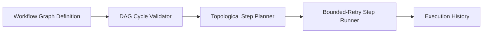

# Workflow Automation DAG Engine (TypeScript / Node.js)


**Stack:** `TypeScript · Node.js · DAG Topological Execution · Bounded Retries`

## Overview
A workflow automation engine that validates directed acyclic graph (DAG) step dependencies, detects circular graphs prior to execution, and runs multi-step automation pipelines with bounded retries.

## Architecture & Execution Flow


## Key Engineering Capabilities
- **Graph Cycle Detection:** Validates workflow step topologies upfront and rejects cyclic dependency graphs.
- **Deterministic Topological Execution:** Executes workflow nodes in strict dependency order.
- **Step-Level Retry Policies:** Retries transient step failures up to configured bounds while recording execution traces.
- **Node.js Test Runner Suite:** Verified automatically via `node --test` in GitHub Actions.

## Local Verification
Run the self-contained verification suite locally:

```bash
node --test
```

## Documentation
- [Architectural Decisions](docs/DECISIONS.md)
- [Security & Isolation Model](docs/SECURITY.md)
